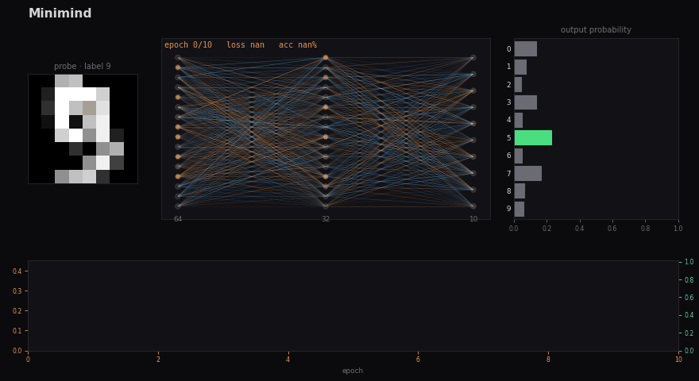

<div align="center">

# Minimind

**A Lightweight Vision-Language Model, Multimodal Search & Neural Engine in Pure NumPy**

[](https://github.com/SiyabongaDlamini/minimind/actions/workflows/ci.yml)
[](https://github.com/SiyabongaDlamini/minimind/releases)
[](https://www.python.org/)
[](https://numpy.org/)
[](LICENSE)

*Train vision-language models, run zero-shot image classification via natural language prompts, index documents for retrieval, and visualize neural network dynamics—without gigabyte deep-learning frameworks.*



</div>

---

## Why Minimind?

Modern ML stacks often require gigabytes of CUDA binaries and opaque abstractions just to classify scans, align images with text, or search local files. **Minimind** implements a complete, vectorised multimodal and neural toolkit in **pure NumPy**—fast enough for CPU production workflows, small enough to audit in an afternoon, and safe to deploy anywhere (`allow_pickle=False` `.npz` weights).

| Capability | `micrograd` | **Minimind** | PyTorch / HuggingFace |
| :--- | :---: | :---: | :---: |
| **Execution Engine** | Scalar Autodiff | **Vectorized NumPy Tensors** | C++ / CUDA |
| **Vision-Language (CLIP / InfoNCE)** | ❌ | **✅ Dual-Encoder VLM** | ✅ |
| **Zero-Shot Prompt Classification** | ❌ | **✅ Built-in** | ✅ |
| **Attention / LayerNorm / GELU** | ❌ | **✅ Analytical Backprop** | ✅ |
| **Document & PDF Retrieval (RAG)** | ❌ | **✅ TF-IDF Passage Index** | External libs |
| **Live Weight & Activation Visualizer** | ❌ | **✅ Matplotlib GIF Export** | TensorBoard |
| **Footprint** | ~100 LOC | **Zero Heavy Frameworks** | > 2 GB |

---

## Core Capabilities

- **Vision-Language Model (`VisionLanguageModel`)** — Dual-tower architecture aligning multi-scale spatial & HOG visual descriptors with subword character n-gram language representations via symmetric **InfoNCE contrastive loss**.
- **Zero-Shot Classification & Cross-Modal Search** — Classify images against arbitrary natural language labels (`"a photo of a square"`, `"damaged part"`) or search image collections using text queries.
- **Modern Neural Building Blocks** — `Dense`, `LayerNorm`, `MultiHeadAttention`, `Dropout`, `GELU`, `ReLU`, `Tanh`, `Sigmoid`, `SoftmaxCrossEntropy`, `InfoNCELoss`, and `AdamW` / `Adam` / `SGD` with gradient norm clipping.
- **Production Parsers (`ImageParser`, `load_csv`)** — Automatic alpha compositing, background polarity detection, bounding-box content cropping, Lanczos scaling, and stratified dataset splitting.
- **Document Question Answering (`KnowledgeBase`)** — Index `.txt`, `.md`, `.rst`, `.csv`, `.json`, `.docx`, and `.pdf` files and extract grounded answers with source attribution.

---

## Installation

```bash
git clone https://github.com/SiyabongaDlamini/minimind.git && cd minimind
pip install -e ".[all]"
```

Or install only the extras your workflow requires:
```bash
pip install -e ".[image]"   # Pillow for image parsing & VLM vision backbone
pip install -e ".[docs]"    # pypdf for PDF ingestion
pip install -e ".[viz]"     # matplotlib + Pillow for live training animations
pip install -e ".[dev]"     # pytest + ruff
```

---

## 1. Vision-Language Model (Zero-Shot & Multimodal Search)

### Python API

```python
from minimind import VisionLanguageModel

vlm = VisionLanguageModel(image_size=(16, 16), hidden_dim=128, embed_dim=64)

# Train on an image folder (subfolder names become natural language prompts)
vlm.fit_folder("data/images", epochs=40, batch_size=16, lr=0.005, verbose=10)
vlm.save("vlm_model.npz")

# Zero-shot classification with natural language prompts
predictions = vlm.zero_shot_classify(
    "data/test_square.png",
    labels=["circle", "square"],
    prompt_template="a photo of a {}",
)
print(predictions)  # [('square', 0.992), ('circle', 0.008)]

# Cross-modal text-to-image retrieval
matches = vlm.search_images(
    query="geometric square shape",
    image_sources=["data/test_square.png", "data/images/circle/circle_00.png"],
    top_k=2,
)
for m in matches:
    print(f"Rank {m.rank}: {m.item} (score={m.score:.3f})")
```

### Command Line

```bash
# Train a contrastive Vision-Language Model on a directory of images
minimind vlm-train --images data/images --size 16x16 --epochs 40 --out vlm.npz

# Zero-shot classify new images using arbitrary text prompts
minimind zero-shot vlm.npz data/test_square.png --labels circle square
```

---

## 2. Neural Network Classifier (Images & Tabular CSV)

```python
from minimind import NeuralNetwork
from minimind.datasets import load_digits

data = load_digits()
train, test = data.split(test_size=0.2)

net = NeuralNetwork(
    [64, 64, 10],
    activation="gelu",
    layer_norm=True,
    dropout=0.1,
)
net.fit(
    train.X,
    train.y,
    epochs=60,
    batch_size=32,
    optimizer="adamw",
    lr=0.005,
    validation=(test.X, test.y),
    verbose=10,
)

loss, accuracy = net.evaluate(test.X, test.y)
print(f"Test accuracy: {accuracy:.1%}")
net.save("digits.npz")
```

### CLI Training & Inference

```bash
# Built-in digits benchmark with live GIF animation export
minimind demo --epochs 60 --animate docs/demo.gif

# Train on an image folder
minimind train --images data/images --size 16x16 --hidden 64,32 --epochs 50 --out image_model.npz
minimind predict image_model.npz data/test_square.png

# Train on a tabular CSV dataset
minimind train --csv data/iris.csv --target species --epochs 50 --out iris_model.npz
```

---

## 3. Document Question Answering (`KnowledgeBase`)

Index local documentation, reports, contracts, or logs and retrieve grounded answers with exact source citations:

```python
from minimind import KnowledgeBase

kb = KnowledgeBase()
kb.add_paths(["data/docs/", "README.md"])

answer = kb.ask("When are production deployments scheduled?")
print(answer)
```

```bash
minimind ask data/docs/handbook.md -q "When are deployments scheduled?"
```

---

## 4. Transformer & Neural Primitives

Every layer in `minimind.layers` implements analytical forward and backward passes verified against finite-difference numerical gradients:

```python
import numpy as np
from minimind import MultiHeadAttention, LayerNorm, GELU

rng = np.random.default_rng(0)
attn = MultiHeadAttention(d_model=64, n_heads=4, rng=rng)
norm = LayerNorm(64)
act = GELU()

x = rng.standard_normal((8, 16, 64))  # (batch, seq_len, d_model)
out = act.forward(norm.forward(x + attn.forward(x)))
```

---

## Architecture Layout

```text
src/minimind/
├── vlm.py         VisionLanguageModel, VisionBackbone (spatial + HOG), TextBackbone (n-gram)
├── layers.py      Dense, LayerNorm, MultiHeadAttention, Dropout, GELU, ReLU, Tanh, Sigmoid
├── losses.py      InfoNCELoss (symmetric contrastive), SoftmaxCrossEntropy, l2_normalize
├── optim.py       AdamW, Adam, SGD, clip_grad_norm
├── network.py     NeuralNetwork: fit / predict / evaluate / save / load
├── parsers.py     ImageParser, load_image_folder, load_csv
├── knowledge.py   KnowledgeBase: document chunking, TF-IDF indexing, grounded Q&A
├── data.py        Dataset (stratified split), Standardizer
├── datasets.py    Built-in handwritten digits dataset
├── viz.py         TrainingRecorder, animate_training
└── cli.py         minimind demo | train | predict | vlm-train | zero-shot | ask
```

---

## Verification & Testing

All analytical gradients (`Dense`, `LayerNorm`, `GELU`, `MultiHeadAttention`, `SoftmaxCrossEntropy`, and `InfoNCELoss`) are tested against numerical finite differences:

```bash
pytest -v
```

---

## License

MIT — see [LICENSE](LICENSE).
